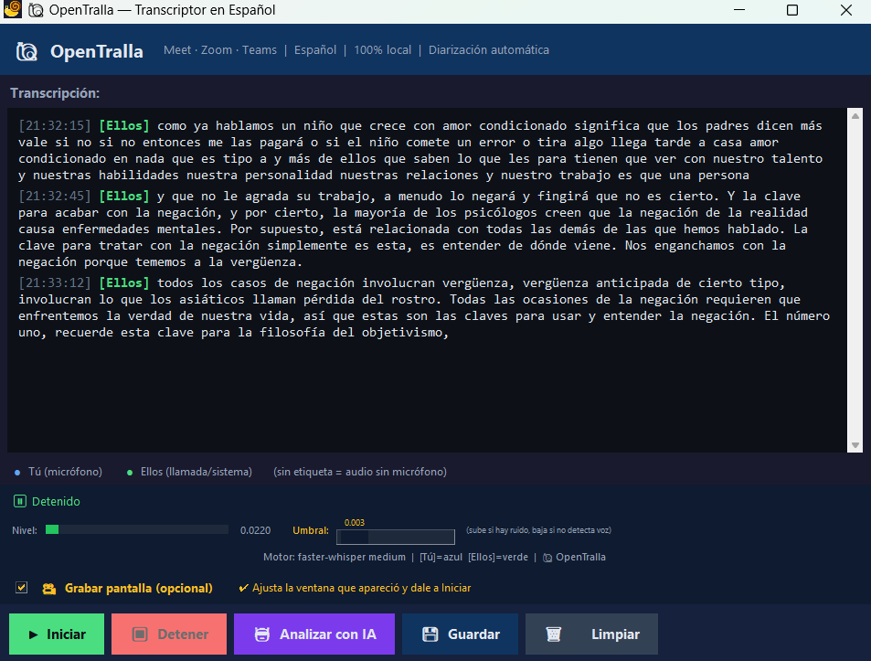

# 🐌 OpenTralla v2.0 Pro — Transcriptor Profesional de Llamadas



Transcribe reuniones de **Google Meet, Zoom, Teams** (o cualquier audio del sistema) directamente en tu PC, **100% local y sin costo**. Grabación de calidad profesional con separación de hablantes.

---

## 🚀 Novedades v2.0 Pro

> **Reescritura completa del motor de audio** usando técnicas profesionales de grabación de llamadas inspiradas en **Twilio**, **Zoom** y call centers.

### ⚡ Antes vs Ahora

| Problema en v1 | Solución en v2.0 Pro |
|---|---|
| 🔴 **Chasquidos/crujidos** al iniciar grabación | ✅ **Modo Callback WASAPI** — el driver de audio entrega datos sin bloqueo |
| 🔴 Buffer de 512 frames causaba **underruns** | ✅ Buffer de **2048 frames** — margen amplio para CPU |
| 🔴 Resampleo forzado a 16kHz **destruía calidad** | ✅ Captura a **tasa nativa** (44100/48000Hz) del dispositivo |
| 🔴 **Se perdía tu voz** — cancelación de eco rompía la señal | ✅ **Detección inteligente** con ratios adaptativos |
| 🔴 Pop/clic al presionar Iniciar | ✅ **Fade-in de 15ms** anti-pop |
| 🔴 Si se cerraba la app, **se perdía todo** | ✅ **Auto-guardado cada 30s** a carpeta `_autosave/` |
| 🔴 Solo 1 archivo WAV mezclado | ✅ **4 archivos WAV** separados + **dual-channel estéreo** |
| 🔴 Transcripción plana sin formato | ✅ **Formato profesional** con separadores + **JSON estructurado** |

---

## ✨ Características

| Función | Detalle |
|---|---|
| 🎙️ **Diarización** | Distingue quién habla: `[Tú]` en azul (micrófono) y `[Ellos]` en verde (llamada) |
| ⚡ **Modo Callback** | Captura no-bloqueante que elimina chasquidos y crujidos |
| 🎧 **Dual-Channel** | Grabación estéreo profesional: tu voz en canal izquierdo, ellos en canal derecho (como Twilio) |
| 🔊 **Tasa Nativa** | Captura a la tasa real del dispositivo (44100/48000Hz) — sin resampleo destructivo |
| 🛡️ **Anti-Pérdida** | Auto-guardado cada 30 segundos — nunca pierdes nada |
| 🎬 **Grabar Pantalla** | Captura de video opcional de la zona que elijas (redimensionable) |
| 🤖 **Análisis con IA** | Resumir, extraer puntos clave o tareas con Gemini, Claude, OpenAI u Ollama |
| 📊 **VU meter** | Visualiza el nivel de audio en tiempo real |
| 🎚️ **Umbral ajustable** | Slider para calibrar la sensibilidad del VAD sin reiniciar |
| 💾 **Guardado Pro** | Exporta: `.txt` formateado, `.json` estructurado, 4 archivos WAV + video `.mp4` |

---

## 🏗️ Arquitectura Profesional

OpenTralla usa las mismas técnicas de grabación que las grandes plataformas:

| Técnica | Twilio/Zoom | OpenTralla v2.0 |
|---|---|---|
| **Canales separados** | `RecordingChannels=dual` | Streams independientes mic/loopback |
| **Sin pérdida** | Almacenamiento en la nube | Auto-guardado local cada 30s |
| **Modo no-bloqueante** | Media servers dedicados | Callbacks WASAPI nativos |
| **Calidad nativa** | Codecs Opus adaptativos | Captura a tasa nativa del dispositivo |
| **Dual-channel** | Izq=agente, Der=cliente | Izq=Tú, Der=Ellos |

### Flujo de audio

```
┌─────────────┐     Callback      ┌──────────────┐
│  Micrófono   │────(no-bloquea)──→│  Cola Mic     │──→ Buffer Mic ──→ _tu.wav
│  (tu voz)    │                   └──────────────┘          │
└─────────────┘                                              │
                                                    ┌────────▼────────┐
                                                    │  VAD + Diariz.  │──→ Whisper 16kHz
                                                    │  (hilo aparte)  │──→ Transcripción
                                                    └────────▲────────┘
┌─────────────┐     Callback      ┌──────────────┐          │
│  Loopback    │────(no-bloquea)──→│  Cola Loop    │──→ Buffer Loop ──→ _ellos.wav
│  (WASAPI)    │                   └──────────────┘
└─────────────┘
```

---

## ⚙️ Instalación

### 1. Requisitos
- Python 3.9+
- Windows 10/11 (WASAPI loopback)

### 2. Instalar dependencias
```
instalar.bat
```

### 3. Iniciar la app
```
iniciar.bat
```

Al primer inicio se descarga automáticamente el modelo de Whisper. Espera a que el estado diga **"Modelo listo"**.

---

## 🚀 Uso

1. **Inicia la llamada** en Meet/Zoom/Teams
2. **Presiona ▶ Iniciar**
3. Las frases aparecen en tiempo real con separadores visuales por hablante
4. **Presiona ⏹ Detener** cuando termines
5. **💾 Guardar** → genera automáticamente todos los archivos

### 📦 Archivos generados al guardar

| Archivo | Contenido |
|---|---|
| `_FECHA.txt` | Transcripción formateada con cabecera y separadores por hablante |
| `_FECHA.json` | Transcripción estructurada con estadísticas y turnos |
| `_FECHA_tu.wav` | 🎤 Solo TU voz (micrófono) a calidad nativa |
| `_FECHA_ellos.wav` | 🔊 Solo la voz de ELLOS (loopback) a calidad nativa |
| `_FECHA_dual.wav` | 🎧 **Estéreo dual-channel**: Tú=izquierdo, Ellos=derecho |
| `_FECHA_mixto.wav` | 🔀 Ambos mezclados para referencia rápida |
| `_FECHA.mp4` | 🎬 Video sincronizado (solo si activaste grabación de pantalla) |

### 📄 Formato de la transcripción (.txt)
```
════════════════════════════════════════════════════════
  OpenTralla v2.0 — Transcripción Profesional de Llamada
  Fecha: 20/04/2026 15:30:45
  Duración: 00:45:23
  Motor: faster-whisper | Captura: Dual-channel WASAPI callback
════════════════════════════════════════════════════════

──── TÚ (Micrófono) ────────────────────────────────────
[15:30:52] [Tú] Bueno, entonces hablemos del proyecto...

──── ELLOS (Llamada) ────────────────────────────────────
[15:31:05] [Ellos] Sí, perfecto. Les cuento que...
```

### 📊 Formato JSON (.json)
```json
{
  "version": "2.0",
  "app": "OpenTralla",
  "fecha": "2026-04-20T15:30:45",
  "duracion": "00:45:23",
  "turnos": [
    {"hora": "15:30:52", "hablante": "Tú", "texto": "Bueno, entonces..."},
    {"hora": "15:31:05", "hablante": "Ellos", "texto": "Sí, perfecto..."}
  ],
  "estadisticas": {
    "total_turnos": 42,
    "turnos_tu": 20,
    "turnos_ellos": 22
  }
}
```

---

## 🛡️ Sistema Anti-Pérdida

OpenTralla guarda automáticamente la transcripción **cada 30 segundos** en la carpeta `_autosave/`:
- Si la app se cierra inesperadamente, tu transcripción está segura
- Se mantienen los últimos 3 auto-guardados (no llena el disco)
- El indicador verde 🛡️ en la interfaz muestra la hora del último guardado

---

## 🎚️ Calibración del umbral VAD

El **slider "Umbral"** en la barra inferior controla cuándo se considera que hay voz:

- **VU meter en cero todo el tiempo** → baja el slider
- **Transcribe ruido de fondo** → sube el slider
- Valor recomendado: el VU meter debe moverse con voz pero quedarse quieto en silencio

---

## 🤖 Análisis con IA (opcional)

Haz clic en **"🤖 Analizar con IA"** después de transcribir. Soporta múltiples proveedores:

| Proveedor | Costo | Cómo obtener clave |
|---|---|---|
| **Gemini** | Gratis (cuota diaria) | [aistudio.google.com](https://aistudio.google.com) → Get API key |
| **Claude** | Pago | [console.anthropic.com](https://console.anthropic.com) |
| **OpenAI** | Pago | [platform.openai.com](https://platform.openai.com) |
| **Ollama** | Gratis (local) | [ollama.com](https://ollama.com) → `ollama pull llama3` |

### Acciones disponibles

| Acción | Qué hace |
|---|---|
| **Resumen ejecutivo** | Resumen corto y conciso de la llamada |
| **Puntos clave** | Lista de los temas y puntos principales tratados |
| **Tareas pendientes** | Extrae compromisos, tareas y próximos pasos |
| **Preguntas y respuestas** | Identifica preguntas formuladas y sus respuestas |
| **Prompt personalizado** | Escribe cualquier instrucción libre |

Las API keys se guardan localmente en `config.json` (excluido de git, nunca se sube).

---

## 🔬 Modelos de Whisper

| Modelo | Velocidad | Precisión | RAM extra | Recomendado para |
|---|---|---|---|---|
| `tiny` | ⚡ Súper veloz | Baja | ~400 MB | PC muy viejas |
| `base` | ⚡ Veloz | Aceptable | ~500 MB | Pruebas rápidas |
| **`small`** ✅ | 🟢 Rápido | Buena | ~1 GB | **CPU — fluido en tiempo real** |
| `medium` | 🟡 Normal | Muy alta | ~2.5 GB | GPU NVIDIA recomendada |
| `large-v3` | 🔴 Lento | Excelente | ~6 GB | Solo GPU NVIDIA |

> **💡 Por defecto se usa `small`** — es fluido en CPU y tiene buena precisión. Si tienes GPU NVIDIA, puedes cambiar a `medium` o `large-v3` para máxima precisión.

### Cambiar modelo

Edita en `transcriptor.py`:
```python
MODEL_SIZE = "small"   # Cambia a "medium" o "large-v3" si tienes GPU
```

### Usar GPU NVIDIA (más rápido)

```python
whisper_model = WhisperModel(MODEL_SIZE, device="cuda", compute_type="float16")
```

---

## 🔧 Diarización: cómo funciona

Sin herramientas externas ni modelos extra — **detección inteligente por ratios adaptativos**:

- **`[Tú]`** → el micrófono tiene actividad significativa relativa al loopback
- **`[Ellos]`** → solo el loopback tiene actividad (o el mic solo capta eco débil)
- **Sin etiqueta** → sin micrófono conectado

> **Nota técnica:** El audio digital del loopback siempre es más fuerte que un micrófono analógico. OpenTralla compensa esto usando ratios de actividad en vez de comparar volúmenes absolutos.

Para mejorar la diarización: asegúrate de que tu micrófono esté configurado como dispositivo de entrada predeterminado en Windows.

---

## 🛠️ Solución de problemas

| Problema | Solución |
|---|---|
| No transcribe nada | Baja el slider de umbral. Verifica que el VU meter se mueva |
| Transcribe ruido | Sube el slider de umbral |
| Se comen palabras | Normal en habla muy rápida; en llamadas normales es mínimo |
| Solo captura un lado | Verifica el micrófono en Windows → Configuración → Sonido |
| Modelo lento | Usa `small` (por defecto). `medium`/`large` necesitan GPU |
| Error de API IA | Verifica que la clave sea válida y que instalaste la librería |
| Se perdió la transcripción | Revisa la carpeta `_autosave/` — tiene las últimas copias automáticas |

---

## 📦 Dependencias principales

- [`pyaudiowpatch`](https://github.com/s0d3s/PyAudioWPatch) — captura WASAPI loopback con callbacks
- [`faster-whisper`](https://github.com/SYSTRAN/faster-whisper) — transcripción ASR local
- `numpy` — procesamiento de audio

---

## 🤝 Contribuciones (Open Source)

¡Este proyecto es 100% de código abierto (*Open Source*)! 
Si tienes ideas para mejorar OpenTralla, has encontrado algún error, o quieres agregar nuevas y geniales funcionalidades, ¡tus contribuciones son más que bienvenidas! 

Siéntete libre de hacer un *fork* del repositorio, trabajar en tus mejoras y enviar un *Pull Request*. ¡Hagamos crecer esta herramienta juntos!
